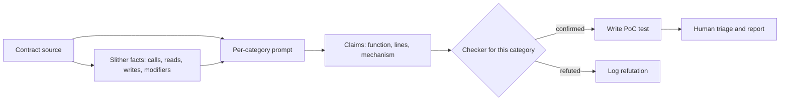

# A Working Taxonomy for Modern Contract Bugs

The SWC Registry was a useful start but is no longer maintained and stops short of DeFi-era bugs. A model's output is only as good as the categories you prompt it with, so this chapter gives a taxonomy designed for **prompting and triage**. Each entry has a one-line detection hint you can paste into a prompt.

## Reentrancy family
- **Classic single-function:** external call before state update. *Hint: find call → state write ordering.*
- **Cross-function:** the attacker re-enters a *different* function sharing state. *Hint: list functions that read state written after an external call.*
- **Read-only reentrancy:** a view function returns stale values mid-call (famous with Curve pool `get_virtual_price`). *Hint: which external protocols read our views during callbacks?*
- **Token-hook reentrancy:** ERC-777 `tokensReceived`, ERC-721/1155 receivers, native ETH `receive`.

## Price and oracle
- **Spot price from AMM reserves:** manipulable in one block.
- **TWAP with short windows or low liquidity.**
- **Stale Chainlink data:** missing `updatedAt` and round checks, or no L2 sequencer-uptime check.
- **Decimals mismatch** between oracle and token.

## Accounting and precision
- **ERC-4626 inflation / first-depositor attack:** donation that makes `shares = 0` for the next depositor.
- **Rounding direction:** should round *against* the user; models often miss which way `mulDiv` rounds.
- **Fee-on-transfer and rebasing tokens:** received amount ≠ `amount` parameter.
- **Reward-per-share update ordering:** rewards accrued before the balance change.

## Authorisation
- **Unprotected initialiser** on implementation or proxy.
- **`tx.origin` auth**, now rarer but still present.
- **Signature replay:** missing nonce, chain ID or contract address in the signed digest. **Malleability** with raw `ecrecover`.
- **Permit/Permit2 misuse:** trusting `permit` success while front-runners can consume it (permit griefing).

## Upgradeability
- **Storage collisions** between proxy and implementation, or across upgrades.
- **Uninitialised implementation `selfdestruct`/`delegatecall`** (historic Parity-style; post-Dencun `selfdestruct` semantics changed with EIP-6780).
- **Function selector clashes** in transparent proxies.

## Cross-chain and L2
- Message replay across chains, missing source-chain validation, `msg.sender` aliasing on L1→L2 messages.

## Denial of service and griefing
- Unbounded loops over user-growable arrays, push payments to reverting receivers, and dust positions that block liquidations.

## Using the taxonomy in prompts

Asking "find vulnerabilities" invites a wall of generic findings. Ask per category instead:

> For category **Accounting/Rounding**, list each arithmetic expression that converts between assets and shares. For each, state the rounding direction and whether it favours the protocol or the user. Cite line numbers. If none, say none.

Per-category prompts produce narrower, checkable claims, and "say none" reduces invented findings.

## Mapping categories to checkers

A taxonomy is only useful if each label leads to a next step. The table pairs each family with the cheapest tool that can confirm a model's claim.

| Family | First mechanical check | Executable evidence |
|---|---|---|
| Reentrancy | Slither `reentrancy-eth`, `reentrancy-no-eth`, `reentrancy-benign` | test with a re-entering receiver |
| Price/oracle | data flow from `getReserves`, `slot0`, `balanceOf(pair)` to price | fork test that moves the price inside one transaction |
| Stale oracle | search for `latestRoundData` without `updatedAt` check | test with a mocked aggregator returning old data |
| Accounting/precision | list conversions; check `Math.Rounding` argument | fuzzed round-trip test; Halmos symbolic test |
| Authorisation | Slither `arbitrary-send-eth`, `suicidal`, `unprotected-upgrade`; modifier listing | call as an unprivileged address |
| Upgradeability | `slither-check-upgradeability`; OpenZeppelin Upgrades plugin storage layout validation | storage layout diff between versions |
| Cross-chain | manual review of message validation | local two-chain test with mocked bridge |
| DoS/griefing | loops over storage arrays | gas measurement test with large arrays |

## How the taxonomy feeds a pipeline



## Worked example: a rounding-direction review

Not executed in this book's CI; the commands, code and expected outputs below are illustrative. Verify locally before relying on them.

Rounding bugs are a good test of the taxonomy because they are small, common and easy to check.

**Step 1 – enumerate conversions mechanically.** List every place that converts between assets and shares:

```bash
grep -nE "mulDiv|convertTo(Shares|Assets)|preview(Deposit|Mint|Withdraw|Redeem)" src/*.sol
```

**Step 2 – per-category prompt.** Give the model those lines plus the ERC-4626 rule of thumb: `deposit` and `redeem` round down shares/assets given to the user; `mint` and `withdraw` round up what the user pays. Ask for a table: function, expression, actual rounding, required rounding, verdict.

**Step 3 – check each "mismatch" claim with a concrete-number test.** For example, if the model claims `previewWithdraw` rounds down:

```solidity
function test_withdraw_rounds_up() public {
    // _seedVault is your own helper that sets totalAssets/totalSupply
    // so the division is inexact
    _seedVault({assets: 1000, shares: 999});
    uint256 shares = vault.previewWithdraw(1);
    // paying for 1 asset must cost at least ceil(1 * 999 / 1000) = 1 share
    assertGe(shares, 1);
}
```

**Step 4 – generalise with fuzzing.** Turn the concrete test into a fuzz test over `assets` and the vault state, using `bound()`. If Foundry finds an input where a round trip returns more than was put in, you have a real finding.

**Step 5 – record the result** under the taxonomy label, with the test, so the next review of a similar vault can retrieve it.

## Common pitfalls

- **Prompting with the SWC list only.** It misses most DeFi-era categories (oracles, ERC-4626 inflation, permit griefing).
- **Merging categories.** "Reentrancy" covering read-only, cross-function and hook-based variants hides the specific question to ask.
- **No "none" option.** Without permission to answer "none", models invent a finding per category.
- **Assuming OpenZeppelin defaults everywhere.** Forks and custom maths libraries change rounding and access-control behaviour.
- **Forgetting token behaviour.** Fee-on-transfer, rebasing and ERC-777 tokens break assumptions that the code under review never states.

## Exercises

1. Map ten Solodit high-severity findings to this taxonomy. Which ones do not fit, and what category would you add?
2. Write a per-category prompt for read-only reentrancy and test it on a contract that integrates Curve or Balancer pools.
3. Build a minimal ERC-4626 vault vulnerable to inflation, and a fixed version using virtual shares (OpenZeppelin's approach).

## Further reading

- SWC Registry (historic): <https://swcregistry.io>
- OpenZeppelin ERC-4626 inflation-attack notes: <https://docs.openzeppelin.com/contracts/5.x/erc4626>
- EIP-6780 (SELFDESTRUCT change): <https://eips.ethereum.org/EIPS/eip-6780>
- Chainlink data feed best practices: <https://docs.chain.link/data-feeds>
- Secureum resources: <https://secureum.substack.com>
